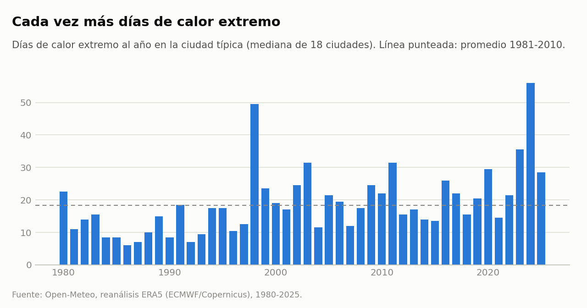
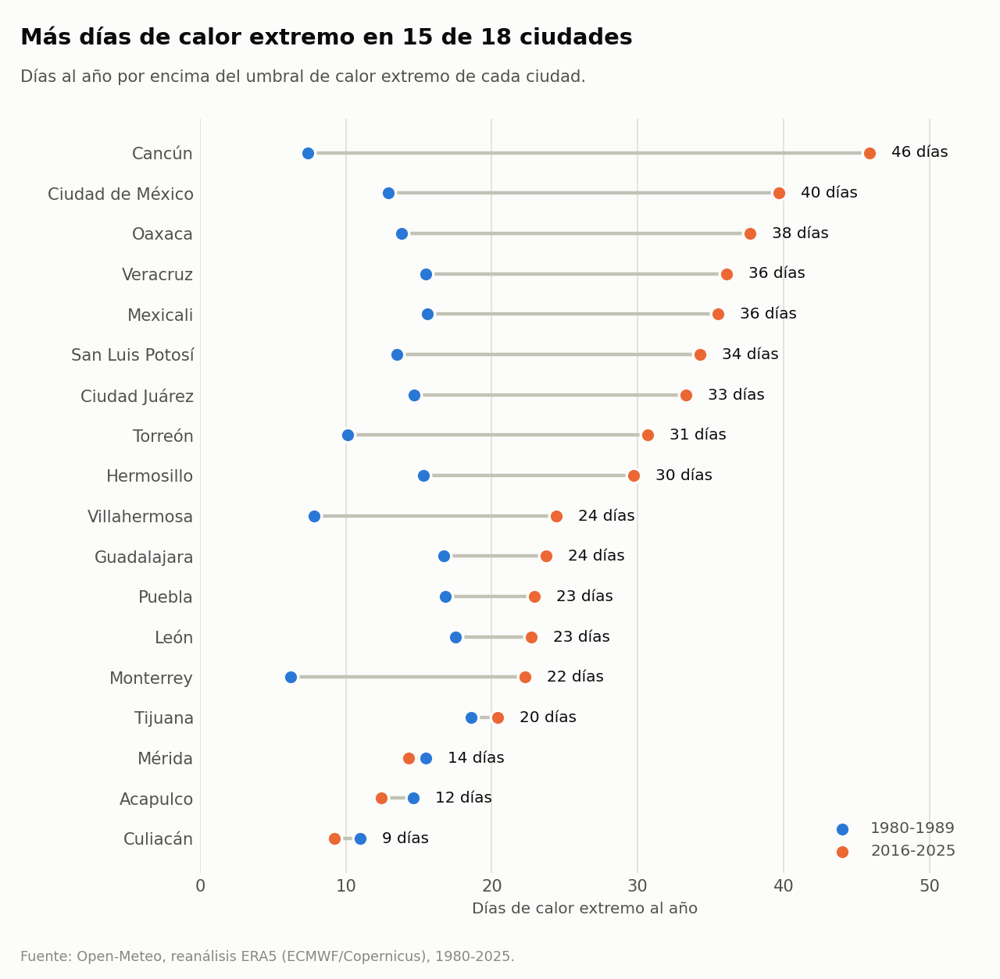

# Calor extremo MX

**¿Cuántos días de calor extremo más hay hoy que en los años 80?**
46 años de temperaturas diarias en 18 ciudades de México.

> **English summary.** Counts very hot days per year (above each city's own 95th percentile of 1981-2010 daily maximum temperature) for 18 Mexican cities, 1980-2025, using ERA5 reanalysis via the Open-Meteo API. The typical city went from 12 to 27 very hot days per year. The project also documents a data-quality trap: the API's default setting silently switches weather models in 2017 and fabricates a 2.6 °C jump; pinning a single model fixed it.

## Hallazgos

**1. La ciudad típica pasó de 12 a 27 días de calor extremo al año** entre la década de 1980 y la de 2016 a 2025.



**2. Hay más días de calor extremo en 15 de 18 ciudades, y en 10 al menos se duplicaron.** Cancún pasó de 7 a 46 días al año; Ciudad de México, de 13 a 40; Monterrey, de 6 a 22.



**3. 2024 fue el año más extremo del registro:** 56 días en la ciudad típica, seguido de 1998 con 50.

**4. Tres ciudades no siguen la tendencia.** En Mérida, Acapulco y Culiacán los días de calor extremo no aumentaron, aunque su temperatura máxima promedio sí subió entre 0.3 y 1.0 °C.

**5. Poco calentamiento basta para muchos días extremos.** La máxima promedio de Cancún subió 0.8 °C y sus días de calor extremo se multiplicaron por seis: en un clima costero casi todos los días se parecen, así que un pequeño corrimiento cruza el umbral muchas más veces.

| Ciudad | Umbral de calor extremo | Días al año, 1980-1989 | Días al año, 2016-2025 | Veces más |
|---|---:|---:|---:|---:|
| Cancún | 31.1 °C | 7.4 | 45.9 | 6.2 |
| Ciudad de México | 28.7 °C | 12.9 | 39.7 | 3.1 |
| Oaxaca | 32.2 °C | 13.8 | 37.7 | 2.7 |
| Veracruz | 35.5 °C | 15.5 | 36.1 | 2.3 |
| Mexicali | 43.2 °C | 15.6 | 35.5 | 2.3 |
| Monterrey | 36.5 °C | 6.2 | 22.3 | 3.6 |

Las 18 ciudades están en [`output/city_summary.csv`](output/city_summary.csv).

## Un error que casi se publica

La primera versión decía que Cancún tenía **21 veces** más días de calor extremo y que Ciudad de México se había calentado 2.8 °C. Eran cifras demasiado grandes, así que se revisó la fuente:

| Ciudad de México, máxima promedio | 2010-2016 | 2017-2025 | Salto |
|---|---:|---:|---:|
| Configuración por defecto de la API | 21.8 °C | 24.4 °C | **+2.6 °C** |
| Un solo modelo (ERA5) | 24.2 °C | 24.8 °C | +0.7 °C |

Por defecto, la API combina varios modelos meteorológicos y a partir de 2017 cambia a uno de mayor resolución. El "calentamiento repentino" era un cambio de instrumento, no del clima. La solución fue pedir un único modelo para los 46 años (`models=era5` en [`calor/data.py`](calor/data.py)).

## Método

- **Día de calor extremo:** día cuya temperatura máxima supera el percentil 95 de la propia ciudad en 1981 a 2010, el periodo de referencia climática estándar. Se define por ciudad porque 33 °C es un día cualquiera en Hermosillo y uno extremo en Ciudad de México.
- **Comparación:** promedio anual de 1980 a 1989 frente a 2016 a 2025.
- **Tendencia:** pendiente de la recta ajustada a los valores anuales, en días por década.
- **Ciudad típica:** mediana de las 18 ciudades en cada año.

## Limitaciones

- **Es un reanálisis, no estaciones.** ERA5 reconstruye el clima en celdas de unos 25 km combinando observaciones y modelos. Describe bien las tendencias regionales, pero no el efecto de isla de calor de cada ciudad ni la temperatura de un punto exacto.
- **Ciudades costeras.** Su celda incluye mar, lo que suaviza las máximas. La tendencia es comparable en el tiempo; el valor absoluto, no tanto.
- **Solo temperatura máxima.** No considera humedad ni temperatura nocturna, que también determinan el riesgo para la salud.
- **18 ciudades** elegidas por tamaño y cobertura regional; no es un promedio nacional.

## Reproducirlo

```bash
pip install -r requirements.txt
python -m calor
python -m pytest
```

Los datos ya vienen en `data/tmax_daily.csv` (302,436 filas). Para descargarlos de nuevo: `python -m calor.data`.

## Fuente y licencia

Datos: [Open-Meteo Historical Weather API](https://open-meteo.com/en/docs/historical-weather-api), reanálisis ERA5 de ECMWF/Copernicus, licencia CC BY 4.0. Código bajo licencia MIT.
